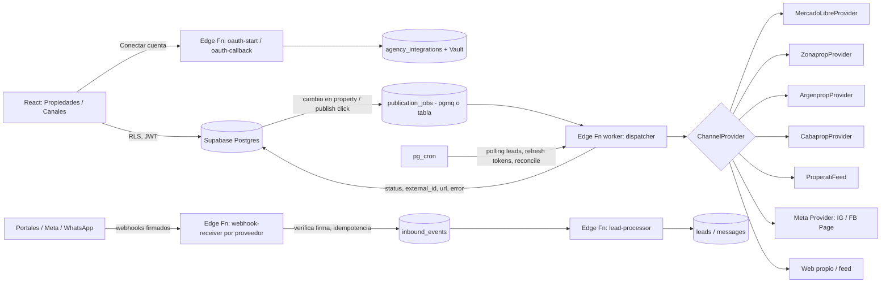

# Integraciones con portales y redes: investigación para el multipublicador de PropMatch CRM

Fecha de la investigación: 2026-10-04.
Alcance: viabilidad técnica y comercial de publicar y recibir leads desde Mercado Libre Inmuebles, Zonaprop, Argenprop, CABAPROP, Properati, Meta (Facebook/Instagram) y WhatsApp.

## Nota metodológica (leer primero)

- Varias páginas oficiales **no se pudieron leer**: la documentación de developers.mercadolibre.com.ar devolvió HTTP 403 al fetch (sólo se vieron los resúmenes del buscador), la doc de Zonaprop/Navent (`open-docs.navent.com`, que redirige a Notion) no renderiza contenido, y la API de Argenprop sólo apareció como un PDF en Scribd (resumen de índice, sin cuerpo).
- Para Zonaprop, Argenprop, CABAPROP y Properati, buena parte de la evidencia viene de **la documentación pública de integradores que ya conectaron** (Mapaprop, 2clics, Kiteprop). Es evidencia sólida de *cómo es el flujo para el usuario final*, pero es evidencia **indirecta** de *cómo se obtiene el acceso de integrador*.
- Todo lo que dice "no verificado" hay que confirmarlo con el portal antes de comprometer fechas o precios.
- Kiteprop, Mapaprop y 2clics son competidores y fuentes comerciales: sus afirmaciones de marketing se usaron sólo para hechos operativos.

---

## 1. Resumen ejecutivo

1. **Mercado Libre Inmuebles** tiene API pública y documentada (OAuth2, `POST /items`, categoría Inmuebles MLA1459, notificaciones por webhook, preguntas y `vis_leads`). Es la única integración de portal que se puede arrancar hoy sin pedir permiso comercial a nadie: alta de app en el DevCenter y listo. Es el primer conector a construir.
2. **Zonaprop** (hoy del grupo QuintoAndar) tiene API de integradores (`open-docs.navent.com`, métodos publicar/editar/borrar/estado/mapeo de zonas/leads) y un canal XML legado. La documentación existe y varios integradores la usan, pero el **acceso como integrador es gestionado con Zonaprop** (no hay alta self-service verificada). 2clics, por ejemplo, figura sin integración con Zonaprop. Requiere acuerdo/credenciales de partner: **no verificado cómo se pide ni cuánto cuesta**.
3. **Argenprop** tiene una API de publicación de avisos propia (spec "v4.0", 45 páginas, vía HTTP POST) que se entrega a integradores. La inmobiliaria pide a Argenprop un usuario de integración (`xxx@api.com`), contraseña, `IdAnunciante`/`IdVendedor`/`IdOrigen`. Se necesita contrato de integrador con Argenprop (no verificado) más el plan/puntos de cada inmobiliaria.
4. **CABAPROP** es el más fácil después de ML: la inmobiliaria genera una **API key** en su panel (Menú, Configuración, Integración) y se la da al integrador. Falta la doc técnica del lado integrador (no verificado: ¿hay que firmar algo con CABAPROP para usar el endpoint?).
5. **Properati** (hoy LIFULL Connect) se alimenta por **feed** (los integradores lo describen como "Feeds API"/feed nocturno), con publicación gratuita para Argentina según Mapaprop. Se necesita acordar el formato y la URL de feed con Properati (no verificado).
6. **Instagram** (publicación de fotos/carruseles) es viable por vía oficial: Instagram Graph API con `instagram_content_publish`, requiere App Review y Business Verification de Meta (semanas). Tope 100 posts/24 h por cuenta.
7. **Facebook Page** también es viable (Pages API, `pages_manage_posts`) con el mismo App Review. **Facebook Marketplace para inmuebles NO tiene vía self-service**: sólo el "Marketplace Partnership Program" para partners aprobados, y no hay evidencia de que cubra Argentina. Alternativa realista: catálogo `home_listings` para anuncios (ads) y publicar en Page/Instagram. No es viable automatizar Marketplace con la web (viola términos).
8. **WhatsApp**: Cloud API oficial con Embedded Signup. Viable para recibir/responder mensajes de leads; hay costo por mensaje de plantilla desde el 1/7/2025 (los mensajes de servicio dentro de la ventana de 24 h son gratis). Requiere verificación del negocio para escalar.
9. **Sitio web propio**: sin dependencia externa; se resuelve con un feed/API propio de PropMatch. Prioridad barata y de alto valor.
10. **No viable**: scraping o automatización de la web de cualquier portal (riesgo de baneo y legal), Marketplace sin ser partner, y cualquier "API unificada" que reemplace los contratos: **no se encontró un agregador/API unificada pública para portales argentinos**; los que existen (Tokko, Kiteprop, Xintel, Mapaprop) son CRMs que tienen sus propios acuerdos con cada portal, no APIs revendibles.

**Orden recomendado de conexión**: sitio web propio, Mercado Libre, Instagram/Facebook Page, CABAPROP, WhatsApp (inbox), y en paralelo gestionar comercialmente Zonaprop, Argenprop y Properati (los trámites tardan más que el código).

---

## 2. Tabla comparativa

| Plataforma | Acceso | Auth | Publica | Leads | Costo (para la inmobiliaria / para PropMatch) | Dificultad | Riesgo | Recomendación |
|---|---|---|---|---|---|---|---|---|
| Mercado Libre Inmuebles | Público: alta de app en DevCenter | OAuth2 (token por inmobiliaria) | Sí, API completa | Webhooks (`questions`, mensajes, `vis_leads`) + polling | Paquete de publicación (silver/gold/gold_premium) a cargo de la inmobiliaria; API sin costo evidente | M | Bajo (rate limit por app, cambios de doc) | Fase 1 |
| Zonaprop | Gestionado: credenciales de API por cuenta + acuerdo con Zonaprop (no verificado) | Login de la cuenta Zonaprop con autorización tipo OAuth (según Mapaprop) o XML legado | Sí (API síncrona o XML ~1 a 12 h) | API de leads (según Mapaprop/Navent) o mail | Plan de publicación de la inmobiliaria; costo para integrador: no verificado | L (por la burocracia) | Medio (dependencia comercial) | Fase 3, gestionar ya |
| Argenprop | Gestionado: spec de API a integradores + usuario `@api.com` por inmobiliaria | Usuario/contraseña de integración + IdAnunciante | Sí (API HTTP POST) | Llegan al inbox del integrador (Mapaprop); mecanismo exacto no verificado | Suscripción por puntos de la inmobiliaria; costo integrador no verificado | M/L | Medio. Ojo: al solicitar integración se dan de baja los avisos activos (2clics) | Fase 3, gestionar ya |
| CABAPROP | La inmobiliaria genera API key en su panel | API key | Sí, con actualización automática | No verificado (Mapaprop no lo detalla) | Gratis (según Kiteprop) | S/M | Bajo | Fase 2 |
| Properati | Feed acordado con Properati | Feed autenticado (según Mapaprop) | Sí, por feed (sync cada 24 h según Mapaprop) | Llegan por el integrador; mecanismo no verificado | Gratis para publicar en AR (Mapaprop); Properati cobra por leads calificados en algunos productos | M | Bajo/medio | Fase 3 |
| Instagram | Público con App Review + Business Verification | OAuth (Meta Login) | Foto/carrusel/Reel/Story; no es "aviso" | Mensajes por Instagram Messaging API (otro permiso) | Gratis | M | Medio (App Review) | Fase 2 |
| Facebook Page | Público con App Review | OAuth, Page token | Posts/fotos/links | Lead Ads y Messenger por webhook | Gratis | M | Medio | Fase 2 |
| Facebook Marketplace (inmuebles) | Sólo partners aprobados | n/a | No self-service | Lead form al partner | n/a | L | Alto | No viable hoy; usar catálogo+ads |
| WhatsApp Business | Público: Cloud API + Embedded Signup | Token de sistema + Embedded Signup | n/a (mensajería) | Webhook de mensajes | Por mensaje de plantilla; servicio gratis en ventana de 24 h | M | Medio (verificación, calidad de número) | Fase 2/4 |
| Sitio web propio | Interno | API key/feed propio | Sí | Formulario a Supabase | Cero | S | Bajo | Fase 0/1 |

---

## 3. Fichas por plataforma

### 3.1 Mercado Libre Inmuebles

1. **API oficial**: sí, pública. Guía de inmuebles: https://developers.mercadolibre.com.ar/introduccion-guia-de-inmuebles y https://developers.mercadolibre.com.ar/productos-recibe-notificaciones/publica-inmueble. Publicar = `POST /items` con token. Además hay doc de desarrollos inmobiliarios (https://developers.mercadolibre.com.ar/desarrollos-inmobiliarios, categoría hija MLA401805), paquetes de inmuebles y tiendas oficiales (https://developers.mercadolibre.com.ar/productos-recibe-notificaciones/gestionar-paquetes-de-inmuebles, https://developers.mercadolibre.com.ar/productos-recibe-notificaciones/publicaciones-de-tiendas-oficiales-para-inmuebles). La categoría raíz de Inmuebles en Argentina es MLA1459 (puede variar; consultar `/categories`).
2. **Acceso**: crear una app en el DevCenter (alta propia, sin contrato). Cada inmobiliaria autoriza la app con su cuenta de Mercado Libre. La inmobiliaria necesita cuenta con el **paquete de publicación (listing_type silver)** con cupo: sin paquete no se puede crear ningún aviso. Si se agota el cupo, el aviso puede despublicarse automáticamente (https://developers.mercadolibre.com.ar/ciclo-de-vida-de-las-publicaciones-de-inmuebles, vía buscador). Existe una guía de tienda oficial para inmobiliarias. Costos de los paquetes en Argentina: no verificado.
3. **Auth**: OAuth2 authorization code con refresh token. PropMatch guarda `access_token` y `refresh_token` por inmobiliaria; la inmobiliaria sólo hace clic en "Autorizar" en Mercado Libre y no comparte credenciales.
4. **Mecánica**: `POST /items` (crear), `PUT /items/{id}` (editar), cambio de `status` a paused/active/closed, `listing_type_id` para destacar (silver, gold, gold_premium). Devuelve `id` (external_id) y `permalink` (external_url). Requiere al menos una imagen en `pictures`; atributos como ROOMS, BEDROOMS, FULL_BATHROOMS y ubicación (ver https://developers.mercadolibre.com.ar/atributos-inmuebles). Campos obligatorios exactos por tipo de propiedad/operación: **no verificado** (doc no accesible); se resuelven consultando atributos de la categoría.
5. **Leads**: notificaciones por webhook (topics a configurar en la app) para preguntas y mensajes, y el topic `vis_leads` para solicitudes de visita (https://developers.mercadolibre.com.ar/solicitud-de-visita, vía buscador); Mapaprop confirma que sus inboxes reciben "questions, messages y vis_leads" (https://www.mapaprop.com/blog/en/posts/2026-04-18-mercadolibre-messages-in-your-inbox). Además se puede consultar por polling.
6. **Límites**: rate limit por Client ID y endpoint, error 429 (https://developers.mercadolibre.com.ar/rate-limit-error-429); se puede pedir aumento de cuota con evidencia de consumo. Cupo de avisos = el del paquete.
7. **Términos**: existen Términos del Programa de Desarrolladores (https://developers.mercadolibre.com.ar/es-ar-terminos-y-condiciones); la página no se pudo leer. Licencia limitada/revocable y reglas de datos personales (visto en el índice). Scraping de la web: no recomendado y innecesario con API.
8. **Esfuerzo**: M (2 a 4 semanas): OAuth, mapeo de atributos, manejo de cupo/paquetes, webhooks.

### 3.2 Zonaprop (Navent, hoy grupo QuintoAndar)

1. **API**: sí, de integradores. Doc oficial en `open-docs.navent.com/arg/` (redirige a https://open-classifieds.notion.site/arg/arg/; **no se pudo leer el contenido**). Mapaprop documenta su implementación: métodos PUT aviso, UPDATE, DELETE, Mapping zone, Get status, Get aviso y leads (https://help.mapaprop.com/en/api/property-api/zonaprop-api, https://www.mapaprop.com/blog/en/posts/2024-06-11-new-zonaprop-api). Hay dos canales: **API síncrona** (publicación instantánea e importación) y **XML** asíncrono (cambios en ~1 h según Mapaprop blog; "hasta 12 h" y mensajes cada hora según su ayuda, https://help.mapaprop.com/en/help/propiedades/publicacion/zonaprop).
2. **Acceso**: la inmobiliaria necesita una cuenta Zonaprop con plan de publicación contratado, y **Zonaprop debe asignar los planes a su "cuenta API"** ("if plans don't appear after verification, contact Zonaprop to ensure they've assigned publication plans to your API account", https://help.mapaprop.com/en/help/mi-inmobiliaria/configuracion/conectar-cuentas/conectar-con-zonaprop). Zonaprop tiene un artículo de ayuda "¿Qué es una integración y cómo la efectúo?" (https://help.zonaprop.com.ar/s/article/Qu%C3%A9-es-una-integraci%C3%B3n-y-c%C3%B3mo-la-efect%C3%BAo) que **no se pudo leer**. Nota de contexto: según comparativas, Tokko, Kiteprop y Xintel integran con Zonaprop y 2clics no (https://www.kiteprop.com/blog/134-mejor-crm-inmobiliario-argentina-2026; fuente competidora), lo que sugiere acceso gestionado. **Cómo y con qué costo se habilita un integrador nuevo: no verificado.**
3. **Auth**: flujo con ventana de login de Zonaprop donde la inmobiliaria ingresa usuario/contraseña de su cuenta, acepta permisos y vuelve ("Verify Connection"). Mapaprop dice que aún les falta implementar "autenticación del lado del servidor" en algunos métodos. Detalle técnico (¿token? ¿OAuth?): no verificado.
4. **Mecánica**: alta/edición/baja por API, status por consulta, **mapeo de zonas** (provincia/ciudad/barrio) propio de Zonaprop que se hace la primera vez por zona. Marcar la propiedad vendida/alquilada **no despublica** en Zonaprop: hay que dar de baja explícitamente. Cada aviso queda guardado por ID, se puede despublicar y republicar sin perder datos. Si el integrador deja de pagar, los avisos se despublican.
5. **Leads**: la API incluye "leads fetch" (resumen de la implementación de Mapaprop); en el canal XML los mensajes se descargan cada hora.
6. **Límites**: cupos según plan de la inmobiliaria (planes/destacados). Fotos y campos obligatorios: no verificado.
7. **Términos**: términos de Zonaprop no leídos. Existen scrapers comerciales de terceros (Apify), pero **no se debe usar scraping** ni automatizar el panel web: viola términos típicos y no aporta nada si hay API.
8. **Esfuerzo**: L en calendario por el trámite comercial; técnico M/L (mapeo de zonas, plan de publicación). No se puede estimar sin la doc completa.

### 3.3 Argenprop

1. **API**: sí, de integradores. Existe la "API de Publicación de Avisos Argenprop" (v4.0, 45 páginas): gestión de vendedores, publicar y modificar avisos, cambiar el estado, parámetros adicionales; requests HTTP por POST; **primero hay que registrar al vendedor** antes de gestionar avisos (https://es.scribd.com/document/282711473/API-de-Publicacion-Argenprop; es una copia en Scribd, posiblemente desactualizada). Argenprop además tiene su CRM gratuito "Argenprop Gestión" (https://gestion.argenprop.com/), que compite con PropMatch en lo básico.
2. **Acceso**: la inmobiliaria solicita la integración a Argenprop, le informa razón social, CUIT, contacto y domicilio, y Argenprop le entrega credenciales (https://ayuda.2clics.app/es/articles/8295818-como-configurar-argenprop-en-la-aplicacion). Hay que ser inmobiliaria argentina y tener suscripción activa. Cómo se habilita un integrador: no verificado.
3. **Auth**: usuario de integración con formato `xxx@api.com`, contraseña, `IdAnunciante`/`IdVendedor` y `IdOrigen` (2clics y Mapaprop). Usar el mail y clave normal "aparece conectado pero no deja publicar" (https://help.mapaprop.com/en/help/mi-inmobiliaria/configuracion/conectar-cuentas/conectar-con-argenprop). Estas son credenciales sensibles: van cifradas en backend.
4. **Mecánica**: publicar/editar vía API; asignar **puntos** de la suscripción a cada aviso para posicionarlo. Marcar vendida/alquilada no despublica. Mapeo de zonas la primera vez. No importa contenido desde el portal: lo que se edite a mano en Argenprop se pisa (https://help.mapaprop.com/en/help/propiedades/publicacion/argenprop). **Advertencia crítica**: al pedir la integración, Argenprop da de baja los avisos activos de la inmobiliaria (2clics), así que hay que cargar todo antes de conectar. Desconectar no despublica.
5. **Leads**: Mapaprop dice que llegan a su inbox de consultas y que las respuestas se reenvían por el portal. Mecanismo técnico (webhook, polling, mail): no verificado.
6. **Límites**: sistema de puntos según suscripción; fotos y campos: no verificado.
7. **Términos**: no leídos (hay Términos de Argenprop Gestión en https://gestion.argenprop.com/StaticView/Terminos). Mismas reglas: no scraping.
8. **Esfuerzo**: M/L.

### 3.4 CABAPROP

1. **API**: sí. Integración por API key (https://help.mapaprop.com/en/help/propiedades/publicacion/cabaprop, https://www.mapaprop.com/blog/en/posts/2023-10-31-publish-to-cabaprop). Documentación técnica del endpoint: no encontrada.
2. **Acceso**: la inmobiliaria, desde su panel de Cabaprop (Menú, Configuración, Integración), genera una API key con nombre del integrador. CABAPROP sólo admite publicaciones de profesionales matriculados (https://www.iprofesional.com/realestate/414294-como-funciona-cabaprop-la-web-que-lidera-la-busqueda-de-venta-y-alquileres-de-inmuebles; fecha según el buscador). Ser integrador oficial: no verificado. Gratis según Kiteprop (https://www.kiteprop.com/integraciones).
3. **Auth**: API key + email de la cuenta.
4. **Mecánica**: publicar con un clic; mientras esté publicado, cambios de precio, fotos, planos y videos se sincronizan; despublicar desde el integrador. Mínimo **3 imágenes**.
5. **Leads**: no verificado.
6. **Límites**: no verificado más allá de las 3 fotos.
7. **Términos**: no leídos.
8. **Esfuerzo**: S/M, bajo riesgo.

### 3.5 Properati

1. **API/feed**: los integradores lo conectan como "Feeds API", por API o feed nocturno autenticado (https://help.mapaprop.com/en/help/propiedades/publicacion/properati). Properati hoy pertenece a LIFULL Connect (https://www.businesswire.com/news/home/20220107005477/es).
2. **Acceso**: no verificado cómo se obtiene la autorización del feed. Publicación gratuita y sin límite de propiedades en Argentina según Mapaprop; otras fuentes dicen que Properati cobra por leads calificados en su modelo para profesionales (https://www.descubre.vc/properati; no verificado).
3. **Auth**: feed autenticado; qué credenciales debe dar la inmobiliaria: no verificado.
4. **Mecánica**: sincronización cada 24 h; se pueden mostrar propiedades vendidas/alquiladas/reservadas.
5. **Leads**: llegan al inbox del integrador con "contact information avanzada" (Mapaprop); mecanismo no verificado.
6. **Límites/campos**: no verificado.
7. **Términos**: no leídos.
8. **Esfuerzo**: M. Conviene escribir primero un feed XML canónico propio, que sirve también a otros portales y al sitio web.

### 3.6 Meta: Instagram y Facebook Page

- **Instagram**: cuenta profesional vinculada a una Página de Facebook. Permisos `instagram_content_publish` (con Facebook Login) o `instagram_business_content_publish` (con Instagram Login), más `pages_read_engagement`. Flujo: `POST /{IG_ID}/media` (container), `POST /{IG_ID}/media_publish`, y chequeo de `status_code`. Tope **100 posts por 24 h móviles** por cuenta (la doc se contradice y el endpoint de límites habla de 50: usar `GET /content_publishing_limit`). Imágenes **sólo JPEG**; carruseles hasta 10 elementos (https://developers.facebook.com/documentation/instagram-platform/content-publishing). Requiere App Review (semanas según fuentes de terceros: https://bundle.social/blog/instagram-api-rate-limits).
- **Facebook Page**: `POST /{page-id}/feed` con `pages_manage_posts` + `pages_read_engagement` + `pages_show_list`; requiere App Review, Business Verification, política de privacidad y video del flujo (https://developers.facebook.com/documentation/pages-api; resumen de terceros en https://postproxy.dev/blog/facebook-graph-api-posting-guide/). Token de Página derivado de token long-lived.
- **Auth**: OAuth de Meta (Facebook Login for Business); la inmobiliaria elige su Página/cuenta en el diálogo. Mapaprop ofrece "una sola conexión" para Instagram y Página (https://help.mapaprop.com/en/help/mi-inmobiliaria/configuracion/conectar-cuentas).
- **Marketplace/inmuebles**: el "Marketplace Partnership Program" permite a "partners externos que cumplan los requisitos" distribuir listings (Item API y Seller API); no se detalla alta, verticales ni países (https://developers.secure.facebook.com/docs/marketplace/partnerships/). Los leads de partners llegan por lead form. **No hay evidencia de disponibilidad de inmuebles en Marketplace Argentina.** Real Estate Ads: catálogo `vertical=home_listings` por Marketing API, feed XML/CSV/TSV, hasta 20 imágenes de 4 MB, descripción 5.000 caracteres; **para commerce se exige negocio verificado** (https://developers.facebook.com/documentation/ads-commerce/marketing-api/real-estate-ads/get-started.md). Eso permite *anunciar* propiedades, no publicarlas en Marketplace.
- **Leads**: Lead Ads (webhook `leadgen`), Messenger/Instagram messaging por webhook (permisos extra de App Review; no verificado en detalle).
- **Esfuerzo**: M (2 a 3 semanas de código + 2 a 6 de espera de revisión).
- **Riesgo legal**: automatizar el navegador sobre Marketplace o perfiles personales viola los términos de Meta y expone a bloqueo de la cuenta.

### 3.7 WhatsApp Business Platform (inbox de leads)

- **API**: Cloud API oficial. Onboarding de cada inmobiliaria por **Embedded Signup**; PropMatch actúa como Tech Provider (tiene que suscribir su app a los webhooks de la WABA del cliente) (https://developers.facebook.com/documentation/business-messaging/whatsapp/changelog/). Se necesita una app Meta con Business Verification de PropMatch, y la inmobiliaria necesita su Business Portfolio y un número dedicado.
- **Coexistence**: permite seguir usando la app WhatsApp Business y la API en el mismo número si el número usó la app al menos 7 días; hay webhooks de historia, sincronización de contactos y "message echoes" (https://docs.360dialog.com/partner/waba-management/phone-number-and-hosting/whatsapp-coexistence/coexistence-onboarding). Útil para inmobiliarias que ya atienden por WhatsApp Business.
- **Precios (desde 1/7/2025)**: cobro por mensaje de plantilla según categoría y país del destinatario; los mensajes de servicio dentro de la ventana de 24 h son gratis, incluidas plantillas de utilidad dentro de ventana; ventana gratis de 72 h para entradas por anuncios Click-to-WhatsApp (https://developers.facebook.com/documentation/business-messaging/whatsapp/pricing). Argentina tiene tarifa propia; un resumen de terceros indica marketing USD 0,0618 y utilidad/autenticación USD 0,0289 (https://docs.gallabox.com/pricing-and-billing-modules/new-per-message-pricing-effective-july-1-2025): **no verificado en la tabla oficial, revisar antes de mostrar al usuario**.
- **Mecánica de leads**: webhook de mensajes entrantes a una Edge Function, abrir ventana de 24 h, responder con texto libre; fuera de ventana, sólo plantillas aprobadas.
- **Riesgos**: calidad del número y límites de mensajería por verificación; prohibido enviar spam; consentimiento. Nunca usar librerías no oficiales que automaticen WhatsApp Web.
- **Esfuerzo**: M/L (inbox, plantillas, estados, verificación).

### 3.8 Sitio web propio

Sin terceros. Exponer un feed JSON/XML público por inmobiliaria, páginas SSR/ISR con schema.org `RealEstateListing` y un endpoint `POST /lead` que cree el lead en Supabase con protección anti-spam. S (1 a 2 semanas). Es también el entorno de prueba del modelo canónico.

### 3.9 Otros portales

- **Doomos, InmoUp, Inmuebles Clarín, Propia, Inmuebles La Capital, La Voz, Infocasas, Proppit, Portal Inmobiliario (Chile), TocToc, Yapo**: figuran como integraciones de Kiteprop, pagas o gratis (https://www.kiteprop.com/integraciones). Detalle técnico de cada uno: no verificado. El que más interesa fuera de AR es **Proppit** (grupo Navent, ver https://help.mapaprop.com/en/help/propiedades/publicacion/proppit).
- **EnBuenosAires**: citado como portal a integrar (https://developargentina.com/blog/software-inmobiliaria-argentina-2026); sin información técnica.
- Estándares de feed: **Kyero XML v3** (muy usado en España/Idealista; máx. 50 fotos según https://faq.witei.com/en/articles/865807-xml-export-with-your-properties), **Trovit/Mitula** y **OpenImmo** (Alemania). **No hay estándar dominante en Argentina**; cada portal local tiene formato/API propio. Sirven como inspiración para el esquema canónico y para portales internacionales futuros.

---

## 4. Cómo lo hacen los líderes

Hallazgos (varios de fuentes comerciales; contrastar):

- **Modelo dominante en Argentina: acuerdo bilateral integrador-portal.** Los CRMs (Tokko Broker, Kiteprop, Xintel, Mapaprop, Adinco, 2clics) tienen cada uno su contrato/credencial con cada portal. Kiteprop declara 30+/40+ portales, Tokko ~15, Xintel 10 a 12, 2clics 15 a 20 sin Zonaprop (https://www.kiteprop.com/blog/134-mejor-crm-inmobiliario-argentina-2026, fuente competidora). Zonaprop incorporó a Tokko Broker en 2018 (https://mercado.com.ar/ruta-digital/zonaprop-amplio-su-base-a-mas-de-11-000-clientes-en-una-decada). La existencia de integradores con y sin Zonaprop apunta a que **el acceso de Zonaprop es un acuerdo comercial**.
- **Flujo "Conectar cuenta" para el usuario final**:
  - Mercado Libre y Meta: OAuth (botón, ventana del proveedor, vuelve conectado).
  - Zonaprop: botón "Vincular cuenta" con login de Zonaprop y permisos, más "Verificar conexión"; a veces hay que pedir a Zonaprop que asigne planes a la cuenta API.
  - Argenprop: la inmobiliaria pide credenciales de integración a Argenprop (por mail) y las pega en el CRM.
  - CABAPROP: genera API key en su panel y la pega.
  - Properati: gratis, sync por feed.
- **Gating comercial del lado del integrador**: Mapaprop exige plan Plus para conectar portales (https://help.mapaprop.com/en/help/mi-inmobiliaria/configuracion/conectar-cuentas); Kiteprop separa integraciones pagas y gratis.
- **Buenas prácticas visibles**: validación de calidad antes de publicar, control de duplicados entre canales, mapeo de zonas una sola vez, métricas de visitas y consultas por portal y costo por lead (Kiteprop, https://www.kiteprop.com.ar/publicar-en-portales-inmobiliarios-argentina).
- **Trampas conocidas** (valen como requisitos de producto): marcar vendida/alquilada no despublica en Zonaprop/Argenprop; ediciones manuales en el portal se pisan; desconectar no despublica en Argenprop; si el integrador cae por falta de pago se despublica en Zonaprop.
- **Argenprop** ofrece su propio CRM gratis (Argenprop Gestión), un competidor directo con integración nativa.
- **EEUU**: Follow Up Boss integra Zillow por programa de partners "Tech Connect" y Realtor.com por API sólo para ciertos leads; el resto se procesa leyendo el email reenviado (https://help.followupboss.com/hc/en-us/articles/360015944914). Zillow adquirió FUB en 2023 (según resumen del buscador). Patrón útil: **el email parser es un fallback universal para leads** cuando no hay API. Rex, Lofty, BoomTown, HubSpot, AppFolio: **no investigados en profundidad (no verificado)**.
- **Agregador/API unificada para portales argentinos**: no se encontró ninguno público con un solo contrato. Lo más cercano son los CRMs con integraciones propias, que podrían ser competidores o, a lo sumo, socios si ofrecen API (Kiteprop dice tener API: https://www.kiteprop.com/integraciones; Tokko tiene API de propiedades y contactos, https://developers.tokkobroker.com/llms.txt). Costos de esos accesos: no verificado.

---

## 5. Arquitectura recomendada

### 5.1 Principios

1. Ninguna credencial de portal en el frontend ni en tablas legibles por el cliente.
2. Un modelo canónico de propiedad y un adaptador por canal detrás de una interfaz común.
3. Todo trabajo hacia el exterior es asíncrono (cola), idempotente y reintentable.
4. Sólo vías oficiales (API/feed/OAuth). Sin scraping ni automatización de la web.

### 5.2 Diagrama



### 5.3 Interfaz común

```ts
interface ChannelProvider {
  id: ChannelId;                                   // 'meli' | 'zonaprop' | ...
  capabilities: { publish: boolean; pause: boolean; leads: 'webhook'|'poll'|'email'|'none' };
  validate(property: CanonicalProperty): ValidationIssue[];       // campos obligatorios por portal
  publish(ctx: AgencyCtx, p: CanonicalProperty): Promise<{ externalId: string; url?: string }>;
  update(ctx, externalId: string, p: CanonicalProperty): Promise<void>;
  pause(ctx, externalId): Promise<void>;
  remove(ctx, externalId): Promise<void>;
  getStatus(ctx, externalId): Promise<{ status: 'live'|'paused'|'rejected'|'pending'; error?: string }>;
  fetchLeads?(ctx, since: Date): Promise<InboundLead[]>;
  verifyWebhook?(req: Request): Promise<boolean>;
}
```

### 5.4 Credenciales y tokens

- Tabla `agency_integrations` **sin políticas SELECT para `authenticated`** para las columnas secretas: sólo `service_role` (Edge Functions) lee secretos. La UI lee una vista `agency_integrations_public` (sin secretos) con RLS por `agency_id`.
- Los secretos se guardan cifrados con **Supabase Vault** (`vault.create_secret`) y la tabla guarda sólo el `secret_id`. Alternativa: `pgsodium`/cifrado de aplicación con clave en secrets de la Edge Function.
- Refresh de tokens (ML, Meta) en un cron; marcar `status='needs_reauth'` si falla y avisar en la UI.
- Rotación y borrado al desconectar (también revocar token en el proveedor cuando se pueda).

### 5.5 Modelo de datos propuesto (ejemplo, NO aplicado)

```sql
-- Integraciones por inmobiliaria
create table agency_integrations (
  id uuid primary key default gen_random_uuid(),
  agency_id uuid not null references agencies(id) on delete cascade,
  channel text not null,                      -- 'meli','zonaprop','argenprop','cabaprop','properati','meta_ig','meta_page','whatsapp','web'
  status text not null default 'disconnected' -- connected | needs_reauth | pending_approval | error | disconnected
    check (status in ('connected','needs_reauth','pending_approval','error','disconnected')),
  external_account_id text,                   -- user_id ML, page_id, IdAnunciante, WABA id
  display_name text,
  secret_id uuid,                             -- referencia a vault.secrets (tokens/claves)
  scopes text[],
  token_expires_at timestamptz,
  settings jsonb not null default '{}',       -- mapeos de zona, plan por defecto, puntos Argenprop
  connected_by uuid references auth.users(id),
  last_sync_at timestamptz,
  last_error text,
  created_at timestamptz default now(),
  unique (agency_id, channel)
);
alter table agency_integrations enable row level security;
-- sin policy de select de la columna secret_id para clientes: exponer una vista segura

-- Cola de trabajos (o pgmq)
create table publication_jobs (
  id bigint generated always as identity primary key,
  agency_id uuid not null,
  property_id uuid not null,
  channel text not null,
  action text not null check (action in ('publish','update','pause','remove','sync_status')),
  idempotency_key text not null unique,        -- p.ej. property_id:channel:action:version
  attempts int not null default 0,
  next_run_at timestamptz not null default now(),
  state text not null default 'queued',        -- queued | running | done | failed | dead
  last_error text,
  created_at timestamptz default now()
);

-- property_publications ya existe (property_id + channel unico, external_id, external_url, status, error_message).
-- Sugerencia de columnas a agregar: content_hash text, last_synced_at timestamptz, rejected_reason jsonb.

-- Eventos entrantes (webhooks) para idempotencia y auditoria
create table inbound_events (
  id bigint generated always as identity primary key,
  channel text not null,
  event_id text,                               -- id del proveedor
  payload jsonb not null,
  received_at timestamptz default now(),
  processed_at timestamptz,
  unique (channel, event_id)
);

-- Mapeos de zona por portal
create table portal_zone_map (
  agency_id uuid, channel text, local_zone_key text, portal_zone_id text,
  primary key (agency_id, channel, local_zone_key)
);
```

### 5.6 Cola, reintentos y errores

- Disparar jobs por trigger al cambiar la propiedad o al hacer clic en "Publicar". El `idempotency_key` incluye una versión o `content_hash` para no republicar sin cambios.
- Worker (Edge Function llamada por `pg_cron`/`pg_net` o pgmq) con backoff exponencial (1, 5, 15, 60 min), máximo de intentos y estado `dead` visible en la UI. Distinguir errores **reintentables** (429, 5xx, timeout) de **de validación** (400: mostrar `error_message` legible en la tarjeta del canal) y de **autenticación** (marcar `needs_reauth`).
- Respetar rate limits por proveedor con un limitador por canal.
- Reconciliación nocturna: `getStatus` de todas las publicaciones activas para detectar bajas externas (cupo agotado en ML, baja por impago en Zonaprop).
- Regla de negocio: cuando la propiedad pasa a vendida/alquilada, **encolar `remove`/`pause` explícito** (Zonaprop y Argenprop no lo hacen solos).

### 5.7 Webhooks entrantes

- Una Edge Function por proveedor. Verificar firma: Meta usa `X-Hub-Signature-256` (HMAC con el app secret) y un `verify_token` en el alta; para Mercado Libre, validar el origen y re-consultar el recurso por API (no confiar en el payload; el mecanismo de firma de ML: no verificado). Responder 200 rápido, guardar en `inbound_events` (idempotencia por `event_id`) y procesar aparte.
- Para portales sin webhook: polling con cron y, como fallback universal, **parser de email** de consultas.

### 5.8 Observabilidad y cumplimiento

- Tabla de logs por llamada externa (canal, acción, status HTTP, latencia, request id) sin datos personales ni tokens; alertas por tasa de errores y por `needs_reauth`.
- Panel de salud de integraciones por inmobiliaria.
- Privacidad (Ley 25.326 de Protección de Datos Personales, Argentina; revisar con asesor legal): leads con datos personales sólo con RLS por `agency_id`, retención definida, sin enviarlos a terceros no declarados. Los términos de ML tratan los datos personales con obligaciones específicas.
- Sin scraping ni uso de cuentas de usuario por navegador automatizado.
- Mínimo privilegio en scopes; documentar para App Review de Meta política de privacidad, borrado de datos y video de flujo.

---

## 6. Hoja de ruta por fases

| Fase | Qué | Por qué primero | Esfuerzo | Dependencias externas (las gestiona el dueño del producto) |
|---|---|---|---|---|
| 0 | Esquema canónico de propiedad, `agency_integrations`, cola, Vault, UI de estado. Sitio web propio + feed XML/JSON | Es la base; no depende de nadie | 2 a 3 sem | Ninguna |
| 0b (en paralelo, día 1) | **Trámites**: contactar Zonaprop, Argenprop y Properati como integrador; iniciar Business Verification de PropMatch en Meta y App Review | Los tiempos son de terceros y largos | Gestión | Contrato/credenciales de integrador; documentación completa de cada API; costos |
| 1 | Mercado Libre (OAuth, publicar/editar/pausar, preguntas y `vis_leads`) | Único portal de acceso self-service y gran volumen | 3 a 4 sem | Alta de app en DevCenter; cuenta ML de prueba con paquete |
| 2 | Instagram + Facebook Page; CABAPROP | Alcance rápido con vías oficiales; CABAPROP es API key simple | 3 a 4 sem | App Review y Business Verification de Meta; confirmar con CABAPROP que PropMatch puede usar el endpoint |
| 3 | Argenprop, Zonaprop, Properati (según avance de acuerdos) | Alto valor comercial pero dependen del contrato | 3 a 6 sem c/u una vez con doc | Acuerdos y credenciales de integrador; cuentas piloto con plan |
| 4 | WhatsApp Cloud API: inbox, plantillas | Mejora el seguimiento de leads de todos los canales; costo variable | 4 a 6 sem | Business Verification, Embedded Signup como Tech Provider, definición de precios a repasar |
| 5 | Facebook Marketplace/ads de inmuebles | Sólo si Meta habilita partner o catálogo | n/d | Aprobación Meta (no verificada para AR) |

Criterio general: primero lo que no depende de aprobaciones, mientras se gestionan en paralelo las que sí.

Mitigación si los portales tardan: ofrecer **exportación de feed/XML y "copiar datos"** más un **parser de email** para leads, de modo que el multipublicador ya entregue valor.

---

## 7. Textos para el usuario final (UI, español rioplatense)

> Sólo se afirma lo verificado. Los bloques marcados "depende de acuerdo" no deben mostrarse como disponibles hasta cerrar el trámite.

### Mercado Libre Inmuebles
**Qué logra**: publicás y actualizás tus propiedades en Mercado Libre Inmuebles desde PropMatch y recibís las consultas y pedidos de visita en tu bandeja.
**Qué necesitás**
- Una cuenta de Mercado Libre a nombre de la inmobiliaria.
- Un paquete de publicación de Inmuebles con lugar disponible.
**Cómo conectarla**
1. Entrá a Configuración, Canales y tocá "Conectar Mercado Libre".
2. Iniciá sesión en Mercado Libre con la cuenta de la inmobiliaria.
3. Aceptá los permisos que te pide PropMatch.
4. Volvé a PropMatch: vas a ver tu cuenta como "Conectada".
5. Elegí el tipo de destaque por defecto y publicá una propiedad de prueba.
**Tiempo estimado**: 3 minutos.
**Advertencia**: si se te agota el cupo de tu paquete, Mercado Libre puede pausar avisos. PropMatch te avisa cuando pasa.

### Zonaprop (depende de acuerdo)
**Qué logra**: publicás tus propiedades en Zonaprop sin volver a cargarlas.
**Qué necesitás**
- Cuenta de Zonaprop con un plan de publicación contratado.
- Que Zonaprop habilite tu cuenta para integraciones y asigne los planes (a confirmar con Zonaprop).
**Cómo conectarla**
1. Escribile a Zonaprop pidiendo habilitar la integración con PropMatch.
2. En Configuración, Canales, tocá "Conectar Zonaprop".
3. Iniciá sesión con tu usuario de Zonaprop y aceptá los permisos.
4. Tocá "Verificar conexión" y revisá que aparezcan tus planes.
5. Mapeá tus zonas la primera vez que publiques en cada una.
**Tiempo estimado**: depende de la respuesta de Zonaprop (a confirmar).
**Advertencia**: marcar una propiedad como vendida o alquilada no la baja de Zonaprop; PropMatch la da de baja por vos. No edites los avisos a mano en Zonaprop, porque se pisan.

### Argenprop (depende de acuerdo)
**Qué logra**: publicás en Argenprop desde PropMatch y asignás tus puntos a cada aviso.
**Qué necesitás**
- Suscripción activa en Argenprop.
- Las credenciales de integración que te manda Argenprop: usuario (termina en `@api.com`), contraseña e ID de anunciante. No sirven tu mail y clave de siempre.
**Cómo conectarla**
1. Pedile a Argenprop la integración con PropMatch (te piden razón social, CUIT y datos de contacto).
2. Antes de pedirla, cargá todas tus propiedades en PropMatch.
3. En Configuración, Canales, tocá "Conectar Argenprop".
4. Pegá usuario, contraseña e ID de anunciante.
5. Tocá "Verificar" y asigná puntos a tus avisos.
**Tiempo estimado**: a confirmar con Argenprop.
**Advertencia**: al activar la integración, Argenprop puede dar de baja los avisos que ya tenías publicados, y desconectar PropMatch no los despublica.

### CABAPROP
**Qué logra**: publicás en CABAPROP con un clic y se mantienen sincronizados precio, fotos y planos.
**Qué necesitás**
- Cuenta de administrador en CABAPROP (profesional matriculado).
- Mínimo 3 fotos por propiedad.
**Cómo conectarla**
1. En CABAPROP andá a Menú, Configuración, Integración.
2. Creá una clave API y ponele de nombre "PropMatch".
3. En PropMatch, Configuración, Canales, tocá "Conectar CABAPROP".
4. Pegá tu mail de CABAPROP y la clave API.
5. Publicá una propiedad para probar.
**Tiempo estimado**: 5 minutos.
**Advertencia**: la clave es como una contraseña: no la compartas por otro medio. (Mostrar sólo cuando se confirme el uso autorizado del endpoint por parte de PropMatch.)

### Properati (depende de acuerdo)
**Qué logra**: tus propiedades se publican en Properati mediante un feed, sin cargarlas de nuevo.
**Qué necesitás**
- Que Properati habilite la recepción del feed de PropMatch (a confirmar).
**Cómo conectarla**
1. En Configuración, Canales, activá "Properati".
2. Elegí qué propiedades querés enviar.
3. Esperá la sincronización (puede tardar hasta 24 horas, según lo informado por otros integradores).
**Tiempo estimado**: a confirmar.
**Advertencia**: la actualización no es instantánea.

### Instagram
**Qué logra**: publicás fotos de tus propiedades en tu Instagram profesional.
**Qué necesitás**
- Cuenta de Instagram profesional (empresa o creador) vinculada a una página de Facebook.
- Ser administrador de esa página.
**Cómo conectarla**
1. En Configuración, Canales, tocá "Conectar Instagram y Facebook".
2. Iniciá sesión en Facebook y elegí la página y la cuenta de Instagram.
3. Aceptá los permisos.
4. Elegí el texto base del epígrafe y publicá.
**Tiempo estimado**: 5 minutos.
**Advertencia**: Instagram acepta imágenes en JPEG y hasta 10 por carrusel, con un tope de 100 publicaciones por día por la API. Esto no es un aviso clasificado: es una publicación del feed.

### Facebook (Página)
**Qué logra**: publicás tus propiedades como posteos en tu página de Facebook.
**Qué necesitás**
- Ser administrador de la página de la inmobiliaria.
**Cómo conectarla**
1. Usá el mismo botón "Conectar Instagram y Facebook".
2. Elegí la página.
3. Aceptá los permisos.
4. Publicá desde la ficha de la propiedad.
**Tiempo estimado**: 5 minutos.
**Advertencia**: esto publica en tu página, no en Facebook Marketplace. Marketplace de inmuebles todavía no está disponible desde PropMatch.

### WhatsApp
**Qué logra**: recibís y respondés las consultas por WhatsApp dentro de PropMatch, con historial por lead.
**Qué necesitás**
- Un número de WhatsApp para la inmobiliaria.
- Acceso de administrador a tu cuenta de Facebook/Meta Business.
**Cómo conectarla**
1. En Configuración, Canales, tocá "Conectar WhatsApp".
2. Iniciá sesión con Facebook y elegí o creá tu cuenta de WhatsApp Business.
3. Verificá el número con el código que recibís.
4. Si ya usabas la app WhatsApp Business en ese número (más de 7 días), elegí mantener las dos formas de uso.
5. Mandá un mensaje de prueba.
**Tiempo estimado**: 10 a 15 minutos, más la verificación del negocio si Meta la pide.
**Advertencia**: podés responder libremente durante 24 horas desde el último mensaje del cliente. Pasado ese tiempo sólo se pueden mandar plantillas aprobadas, y esas pueden tener costo por mensaje que cobra Meta.

### Sitio web propio
**Qué logra**: tu catálogo se publica solo en tu sitio y las consultas entran como leads.
**Qué necesitás**
- Elegir qué propiedades se muestran.
**Cómo conectarla**
1. En Configuración, Sitio web, activá "Publicar en mi sitio".
2. Elegí el diseño y el dominio (o usá el que te damos).
3. Marcá las propiedades públicas.
4. Probá el formulario de contacto.
**Tiempo estimado**: 10 minutos.
**Advertencia**: ninguna.

---

## 8. Preguntas abiertas, riesgos y qué no se pudo verificar

**No verificado (confirmar antes de decidir):**
1. Todo el contenido de `open-docs.navent.com` (Zonaprop): autenticación real, endpoints, campos obligatorios, límites de fotos, planes, formato de leads. Tampoco se leyó el artículo oficial de Zonaprop sobre integraciones.
2. Cómo se obtiene y cuánto cuesta el acceso de **integrador** a Zonaprop, Argenprop y Properati; si hay exclusividad, certificación o revenue share.
3. Cuerpo de la spec de Argenprop (sólo se vio el índice, versión de Scribd posiblemente vieja), y cómo llegan sus leads.
4. Documentación completa de Mercado Libre (403 al fetch): campos obligatorios por tipo, límites de fotos, cuotas, firma de webhooks, costo de paquetes, cláusulas de los términos sobre scraping y datos.
5. Documentación técnica de CABAPROP y cómo llegan sus leads; si se necesita acuerdo con CABAPROP.
6. Aplicabilidad del Marketplace Partnership Program de Meta a inmuebles en Argentina.
7. Tarifas de WhatsApp para Argentina (valor de terceros, revisar la tabla oficial), y plazos reales de App Review/Business Verification.
8. Rex, Lofty, BoomTown, HubSpot, AppFolio, RE/MAX/Century 21 y los detalles de Xintel y Tokko (portales y flujo): no se investigaron con profundidad.
9. La condición de propiedad de Zonaprop: una fuente la ubica en QuintoAndar (https://mercado.com.ar/ruta-digital/zonaprop-amplio-su-base-a-mas-de-11-000-clientes-en-una-decada, https://www.baenegocios.com/amp/Unicornio-brasileno-compro-la-plataforma-local-de-inmuebles-Zonaprop-20211223-0048/); un resultado de terceros decía Mercado Libre, lo cual no se corroboró y no se usó.

**Riesgos:**
- Dependencia comercial: sin los acuerdos de Zonaprop y Argenprop, el multipublicador cubre menos de lo que el mercado espera como mínimo (Zonaprop, Argenprop y Mercado Libre se consideran el piso: https://developargentina.com/blog/software-inmobiliaria-argentina-2026).
- Competidores directos controlan algunos portales (Argenprop Gestión gratis; Tokko, Kiteprop).
- App Review de Meta puede ser rechazado o demorar.
- Cambios de API sin aviso; hay que monitorear changelogs.
- Datos personales de leads: obligaciones legales de la Ley 25.326 y de los términos de cada proveedor.
- Acciones destructivas: al conectar Argenprop se dan de baja avisos previos; la UI debe advertirlo y exigir confirmación explícita.
- Scraping y bots sobre Marketplace, WhatsApp Web o paneles de portales: **descartado**.

**Preguntas para el dueño del producto:**
1. ¿Hay presupuesto para pagar acuerdos de integrador, o se prioriza el camino sin permisos (ML, Meta, WhatsApp, web, CABAPROP)?
2. ¿Se prefiere ofrecer primero "exportación de feed" a las inmobiliarias que ya tienen acuerdo con Zonaprop/Argenprop vía otro CRM?
3. ¿Quién es el titular legal de la app de Meta y de la app de Mercado Libre (razón social de PropMatch)?
4. ¿Qué inmobiliarias piloto pueden prestar cuentas de Zonaprop/Argenprop/CABAPROP para pruebas?
